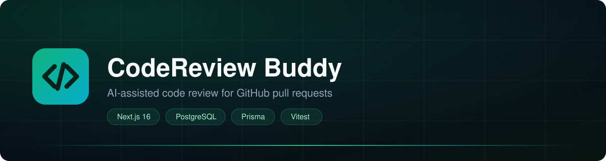
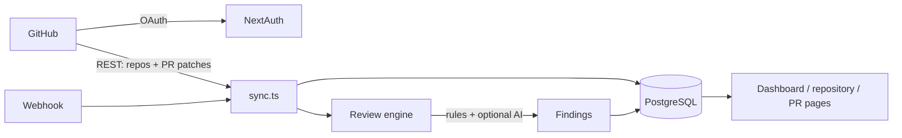

# CodeReview Buddy



[](https://github.com/Subhamdasskd/CodeReviewBuddy/actions/workflows/ci.yml)
[](LICENSE)
[](.nvmrc)

AI-assisted code review and engineering intelligence for GitHub repositories.

Sign in with GitHub, sync your repositories and pull requests, and get structured
review findings — security issues, bugs and style problems — with the file, the line
and a suggested fix.

## Try it without an account

- `/demo` — the dashboard with sample repositories
- `/demo/review` — a sample pull request with findings

Both pages are static and read-only, so they work on any deployment without a
database or GitHub sign-in.

## Features

- **GitHub OAuth** — one click, no personal access tokens to paste
- **Repository + PR sync** — imports every repository you can access and its recent
  pull requests, idempotently
- **Review engine** — 17 deterministic rules covering secrets, injection, XSS,
  unsafe APIs and common bugs, plus an optional AI pass
- **Review dashboard** — findings grouped by severity, filtered by severity,
  dismissible and restorable, with file:line and suggested fixes
- **Re-run on demand** — review any pull request again from its page
- **Webhook reviews** — GitHub notifies the app when a PR is opened or updated,
  and the review runs automatically
- **Encrypted tokens** — GitHub access tokens are stored with AES-256-GCM

## How the review works



1. The GitHub API returns each changed file with a unified diff patch.
2. `src/services/review/diff.ts` parses the hunks and keeps only **added** lines,
   tracking the line number in the new version of the file.
3. `src/services/review/rules.ts` runs the rule set over those lines.
4. If `GEMINI_API_KEY` or `OPENAI_API_KEY` is set, `llm.ts` asks the model for
   additional findings. An AI failure never fails the review.
5. `engine.ts` merges both sources, removes duplicates, sorts by severity and
   stores the result.

## Stack

| Layer | Choice |
|---|---|
| Framework | Next.js 16 (App Router, Turbopack) |
| Language | TypeScript |
| UI | Tailwind CSS v4, lucide-react |
| Auth | NextAuth (GitHub provider, database sessions) |
| Data | Prisma — SQLite locally, PostgreSQL (Supabase) in production |
| Tests | Vitest |

## Local setup

Local development uses SQLite (`prisma/dev.db`), so no database server is needed.

```bash
npm install
cp .env.example .env      # fill in the GitHub OAuth values
npx prisma db push        # creates prisma/dev.db
npm run dev
```

Open <http://localhost:3000>.

### Environment

| Variable | Needed for | Purpose |
|---|---|---|
| `GITHUB_CLIENT_ID` / `GITHUB_CLIENT_SECRET` | always | GitHub OAuth app |
| `NEXTAUTH_SECRET` | always | Session encryption (`openssl rand -base64 32`) |
| `NEXTAUTH_URL` | always | Base URL, e.g. `http://localhost:3000` |
| `DATABASE_URL` | production | Pooled Postgres connection |
| `DIRECT_URL` | production | Direct Postgres connection for migrations |
| `GITHUB_WEBHOOK_SECRET` | optional | Enables automatic reviews from GitHub webhooks |
| `GEMINI_API_KEY` / `OPENAI_API_KEY` | optional | Adds an AI review pass |

GitHub OAuth callback: `<your-url>/api/auth/callback/github`.

## Scripts

| Command | What it does |
|---|---|
| `npm run dev` | Development server |
| `npm run build` | Production build |
| `npm start` | Serve the production build |
| `npm test` | Run the Vitest suite |
| `npm run lint` | ESLint |
| `npx prisma db push` | Apply the schema to the database |

## Project layout

```
src/
├── app/
│   ├── page.tsx                     # landing + dashboard
│   ├── repositories/[id]/page.tsx   # repository detail, PR list
│   ├── pull-requests/[id]/page.tsx  # review findings
│   └── api/
│       ├── github/sync-repos        # repos + PRs + auto-review
│       ├── repos/[id]/prs           # PR list
│       ├── prs/[id]/review          # stored review
│       ├── prs/[id]/review/trigger  # re-run review
│       └── findings/[id]/dismiss    # dismiss / restore
├── components/                      # UI + client widgets
├── lib/                            # auth, prisma, session helpers
└── services/
    ├── github/                      # REST client, repos, PRs
    ├── review/                      # diff parser, rules, LLM, engine
    └── sync.ts                      # orchestration
```

## Deployment (Vercel + Supabase)

1. **Switch the datasource** in `prisma/schema.prisma`:

   ```prisma
   datasource db {
     provider  = "postgresql"
     url       = env("DATABASE_URL")
     directUrl = env("DIRECT_URL")
   }
   ```

2. Create a Supabase project and copy the pooled (`:6543`) and direct (`:5432`)
   connection strings. The project must not be paused.
3. Create the tables:

   ```bash
   DATABASE_URL="<direct>" npx prisma db push
   ```

4. Import the repository into Vercel, then set the environment variables from
   `.env.example` with `NEXTAUTH_URL` pointing at the production URL. `vercel.json`
   already sets the build command to `prisma generate && next build`.
5. Update the GitHub OAuth app callback to
   `https://<your-domain>/api/auth/callback/github`.

## Webhook reviews

1. Set `GITHUB_WEBHOOK_SECRET` to a random string.
2. In the repository: **Settings → Webhooks → Add webhook**
   - Payload URL: `https://<your-domain>/api/webhooks/github`
   - Content type: `application/json`
   - Secret: the same value
   - Events: **Pull requests**
3. Opening, reopening, pushing to, or marking a PR ready triggers a review.

## Limitations

- Reviews also run on sync and on demand, for repositories without a webhook.
- Team analytics, custom rule sets, pattern memory, Slack/Jira and the VS Code
  extension from the PRD are not implemented.

## Documentation

| Document | Contents |
|---|---|
| [CONTRIBUTING.md](CONTRIBUTING.md) | Local setup, scripts, adding a rule, PR checklist |
| [SECURITY.md](SECURITY.md) | Reporting vulnerabilities, deployment checklist |
| [CODE_OF_CONDUCT.md](CODE_OF_CONDUCT.md) | Community expectations |
| [CHANGELOG.md](CHANGELOG.md) | Release history |
| [LICENSE](LICENSE) | MIT |
